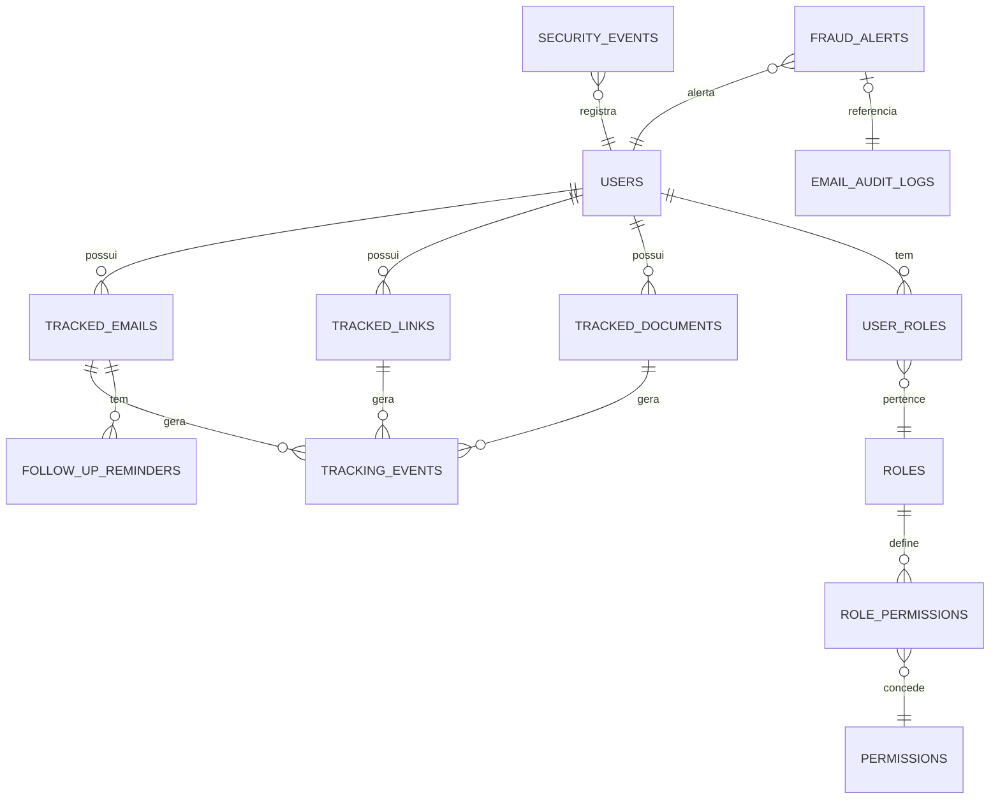

# 📊 Entity Relationship Diagram (ERD) — FUXICO

## Descrição dos Domínios

1. **Auth & Security:** Gerenciamento de usuários, roles (RBAC), logs de segurança e alertas de fraude.
2. **Tracking:** Core do sistema. Emails, links e documentos rastreados e seus respectivos eventos de abertura/clique.
3. **Automation:** Lembretes de follow-up e sequências de email.
4. **Configuration:** Preferências de usuário, whitelists e filtros salvos.
